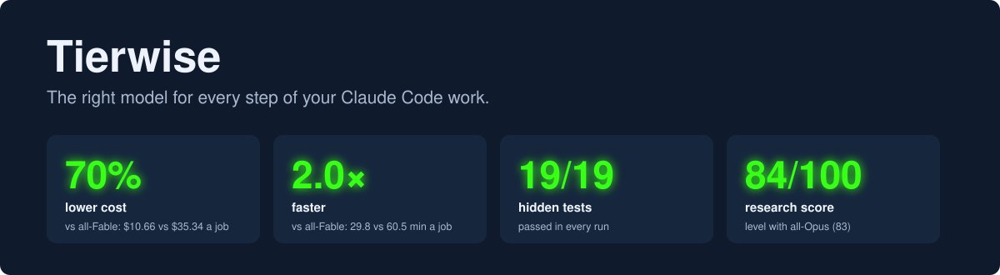
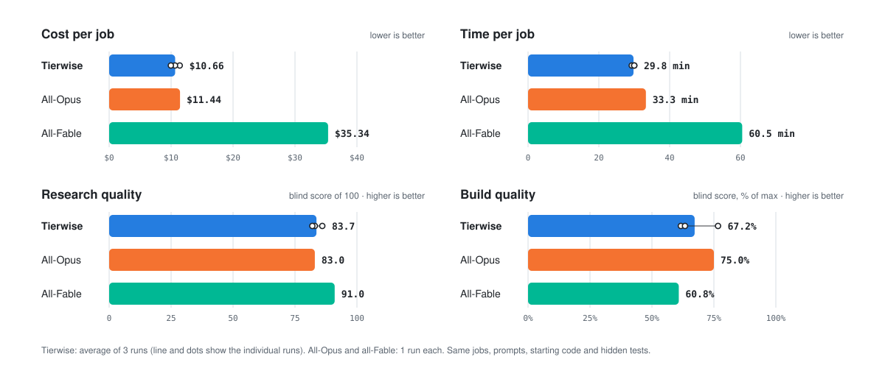
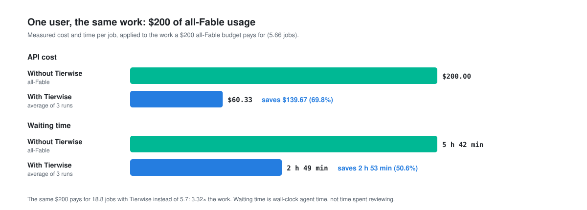
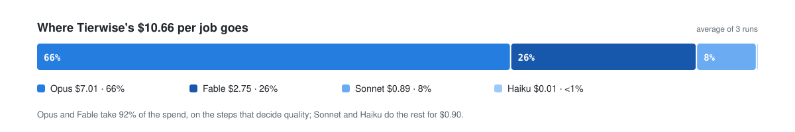

<p align="center">
  
</p>

<p align="center">
  <b>The right model for every step of your Claude Code work.</b><br>
  Fable for plans and hard judgement · Opus for security-sensitive code and review · Sonnet and Haiku for the volume
</p>

<p align="center">
  <a href="LICENSE"></a>
  
  
  
  
</p>

---

Running every agent on the strongest model is expensive and slow, and most of the work does not need it. **Tierwise is a Claude Code plugin that gives each step to the model it actually needs**, enforces that routing every time an agent is started, and refuses to call a change finished until its checks pass.

In a head-to-head evaluation on the same research and build jobs, Tierwise did the work for **70% less than running everything on Fable and 7% less than running everything on Opus**, finished **twice as fast as all-Fable**, passed **all 19 hidden acceptance tests in every run**, and matched all-Opus on research quality in blind judging.

## Performance

<picture>
  <source media="(prefers-color-scheme: dark)" srcset="docs/assets/glance-dark.svg">
  
</picture>

| Per job | Tierwise | All-Opus | All-Fable |
| --- | ---: | ---: | ---: |
| API cost | **$10.66** | $11.44 | $35.34 |
| Time | **29.8 min** | 33.3 min | 60.5 min |
| Hidden acceptance tests | **19/19 in all 3 runs** | 19/19 | 18/19 |
| Research quality (blind, of 100) | 83.7 | 83.0 | **91.0** |
| Build quality (blind, % of max) | 67.2% | **75.0%** | 60.8% |

Tierwise figures are the average of three runs; all-Opus and all-Fable were run once each. Same jobs, prompts, starting code and hidden tests for all three. [Method, data and limits →](docs/evaluation.md)

## Savings

<picture>
  <source media="(prefers-color-scheme: dark)" srcset="docs/assets/savings-dark.svg">
  
</picture>

For a user who spends **$200 on API usage** for this kind of work, from the measured per-job cost and time:

| Each user, $200 baseline | vs all-Fable | vs all-Opus |
| --- | ---: | ---: |
| Same work with Tierwise costs | **$60.33** | $186.36 |
| Saved | **$139.67 (69.8%)** | $13.64 (6.8%) |
| Work the same $200 pays for | **3.32×** | 1.07× |
| Waiting time saved | **2 h 53 min (50.6%)** | 1 h 01 min (10.5%) |

| At scale (each user with their own $200) | 1,000 users | 2,000 users |
| --- | ---: | ---: |
| API spend saved vs all-Fable | **$139,670** | **$279,340** |
| Waiting time saved vs all-Fable | **2,883 h** (360 working days) | **5,767 h** (721 working days) |
| API spend saved vs all-Opus | $13,640 | $27,280 |
| Waiting time saved vs all-Opus | 1,017 h (127 working days) | 2,033 h (254 working days) |

Scaled figures are projections: the measured per-user figures multiplied, assuming similar work. Waiting time is how long the agents run, not time spent writing requests or reviewing results. Costs are list-price equivalents; on a subscription they are usage of your plan's limits. Every calculation is shown in [docs/evaluation.md](docs/evaluation.md).

## How it works

<picture>
  <source media="(prefers-color-scheme: dark)" srcset="docs/assets/mix-dark.svg">
  
</picture>

Your main session stays on Opus, so its prompt cache is never thrown away. Everything else is handed to subagents with a pinned model and effort:

| Work | Agent | Model |
| --- | --- | --- |
| Plans and replans | `tierwise:planner` | Fable |
| Escalation and high-risk diff review | `tierwise:principal` | Fable |
| Code review, security review, fresh-context debugging | `tierwise:reviewer`, `tierwise:security-reviewer`, `tierwise:debugger` | Opus |
| Building specified units (Opus for high-risk code) | `tierwise:builder` | Sonnet |
| Explanations, impact maps, triage | `tierwise:analyst` | Sonnet |
| Lookups and log digests | `tierwise:scout` | Haiku |

1. **Route.** Each prompt gets a routing card: the kind of task, a risk tier (R0–R3), whether it needs a plan, the effort, the agents, tests and security checks. Anything touching auth, secrets, payments, migrations or infrastructure is rated highest risk.
2. **Enforce.** A guard checks every agent start: the right model and effort, review floors by risk, caps on expensive escalations, and nothing below Opus for high-risk code. Haiku is kept to finding things; judgement goes to Sonnet or above.
3. **Verify.** When the session tries to finish, a gate runs the checks the change needs: syntax, a built-in secret scan, your tests, type checks, dependency and static analysis where configured. It blocks with a short digest while they fail, and escalates through a debugging ladder only when the same failure repeats.
4. **Measure.** Every request is priced from the usage the API reports. The status line and `/tierwise-savings` show what the session cost against doing it on one model.

## Install

In Claude Code:

```
/plugin marketplace add sharedptr61/tierwise
/plugin install tierwise@tierwise
```

Then run `/reload-plugins` or restart. The first time, Claude Code asks whether to run Tierwise's mod (in-process code that sets effort per prompt and measures cost); Tierwise also works without it, with coarser effort control.

**Requirements:** Claude Code 2.1.299 or later, Python 3.8+, git; projects must be git repositories. Install or update Claude Code with the native installer (`curl -fsSL https://claude.ai/install.sh | bash`); the npm package can lag behind the required version.

**Platform:** Ubuntu (22.04 and 24.04 LTS). macOS and Windows are not supported in this release; support is planned once they have been tested.

**Recommended companion:** Anthropic's [security-guidance](https://github.com/anthropics/claude-plugins-official) plugin adds per-edit security warnings and an end-of-turn security review; Tierwise's security reviewer reads its project rules too. Install it with `/plugin install security-guidance@claude-plugins-official`.

## Use

Work as you normally would. Each prompt gets its routing card; Tierwise starts the right agents, runs the checks, and keeps its state in `.tierwise/` in your project (excluded from git).

| Command | What it does |
| --- | --- |
| `/tierwise-savings` | Measured cost by model and agent, against all-Opus and all-Fable estimates |
| `/tierwise:commit-message` | A conventional commit message for the staged change |
| `/tierwise:debt` | Lists every `shortcut:` comment with its limit and upgrade trigger |
| `/tierwise:terse` | Short replies until you say "normal mode" |
| `/tierwise:compress-memory <file>` | Shortens a CLAUDE.md, with a backup |

Per-project settings live in `.claude/tierwise.json`, written from auto-detection the first time and confirmed with you once. See the [plugin reference](plugins/tierwise/README.md) for every option.

## Privacy

Tierwise itself sends nothing to any third party. Routing rules, the secret and syntax checks, cost measurement and the ledger all run locally. Its only model calls go through your own Claude Code session: the agents it starts, and a short Haiku classification when a prompt's routing is unclear. Checks you configure run as those tools normally do (for example, `npm audit` and `pip-audit` query their vulnerability databases). Static analysis runs Semgrep only with your project's own rules and with metrics switched off.

**What Tierwise writes, all inside your project:** `.claude/tierwise.json` (its settings), `.tierwise/` (task state, plans, reports and a ledger that records each task's route and the first 200 characters of the prompt that started it), and one line in `.git/info/exclude` so `.tierwise/` stays out of git. It never changes Claude Code's own settings files, and nothing it stores leaves your machine. Delete `.tierwise/` at any time to clear it.

## Evaluation, honestly

- **Research:** Tierwise scored level with all-Opus (83.7 vs 83.0) but below all-Fable (91.0), which both judges ranked first.
- **Builds:** Tierwise averaged ahead of all-Fable (67.2% vs 60.8%) and behind all-Opus (75.0%). Quality varied between runs: the top-scoring build of the whole panel was a Tierwise run, while the other two scored below all-Opus.
- **Scope:** the measurements cover multi-agent research and build workflows with Tierwise's model routing. Three Tierwise runs and one run each of the alternatives is a small sample.

Full method, every number and the raw data: [docs/evaluation.md](docs/evaluation.md) · [evals/workflow-arms/evaluation.json](evals/workflow-arms/evaluation.json) · interactive report: [docs/report.html](docs/report.html) (open locally in a browser).

## Development

```
python3 -m unittest discover -s plugins/tierwise/tests   # Python tests
claude plugin test plugins/tierwise                       # mod tests
claude plugin validate --strict .                         # manifests
python3 docs/assets/make_charts.py                        # redraw the charts from the data
```

See [CONTRIBUTING.md](CONTRIBUTING.md). Security reports: [SECURITY.md](SECURITY.md). Release history: [CHANGELOG.md](CHANGELOG.md).

## Credits

Tierwise's process skills were shaped by ideas from [Superpowers](https://github.com/obra/superpowers) by Jesse Vincent, [Caveman](https://github.com/JuliusBrussee/caveman) by Julius Brussee and Ponytail by Dietrich Gebert; its checks draw on SWE-agent, Gitleaks and Agentless. All of Tierwise is written from scratch; no code or text from them is included. Details in [docs/inventory.md](docs/inventory.md).

## License

[MIT](LICENSE) © 2026 Onur Aktas
